# David's Bible App (DBA v2)

An Android Bible study app built natively in Flutter (not a ported web view).

## Features

### Reading

- Light / Dark / System themes, with optional textures on the body and navbars.
- Split view for two Bible translations side by side.
- Compare a verse, verses, or a whole chapter across multiple translations.
- Verse of the Day with a 24-hour changer.
- Footnotes access for each translation.
- Add your own Inline verse notes: tap to expand, double-tap or long-press to edit.
- Daily Streak and Longest Streak badges, to encourage use.
- Verse History, gets you back to where you were.

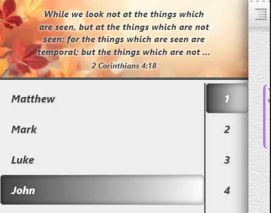

### Highlights

- Box, Text, & Sidelights highlights as an alternative highlight style.

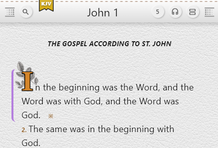

### Search

- Reference and keyword search with multi-section reference requests (e.g. several passages at once).
- Configurable results per page.
- Search history saved.
- Selectable verses to send to the mdEditor, Topics, or display in the Uni-Verse, witnessing Tool.

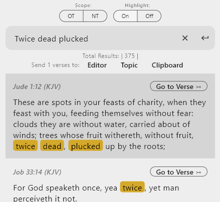

### Audio Bible

- Download audio Bibles online, and back them up locally for offline restore.
- Reader sync / desync, for App navigation without disturbing the current Audio.
- Smooth auto-scroll with manual +/- 5 line adjustment.
- Seekbar that scrolls the reader text with it.
- Android media-tray controls that navigate books, not just chapters.
- Sleep timer.
- Loop Chapter, Book, and in Settings "On Bible End" options available.
- Battery optimizations: animations pause when off-screen or the screen is locked.

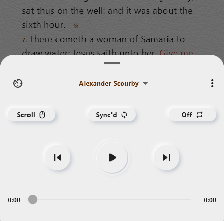

### Study Tools

- **Strong's Dictionary**: integrated, with database download/upload.
- **Cross-References**: integrated, with database download/upload.
- **Uni-Verse Witnessing Tool**: present topical verses, with pinch-to-zoom opening from selected Search verses or within a Topic.

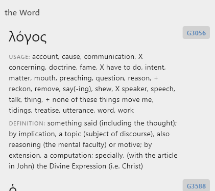

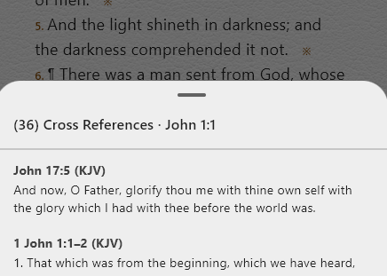

### Gallery

- **Topics**: drag to reorder, with a full detail view.
- **Notes**: edit inline.
- **Bookmarks.**
- Swipe navigation between all gallery tabs.
- Search each: Topics, Notes, and Bookmarks.

### Markdown Editor

- Send selected verses from Search or the Reader straight into the editor, or send a complete Topic.
- Paste Options with a live previewer:  stacked or inline, auto-paste at end of document or at the cursor position.
- Independent light/dark mode from the rest of the app.
- Quick Export, Save As, Open File.
- Full state saved, to continue where you left off.

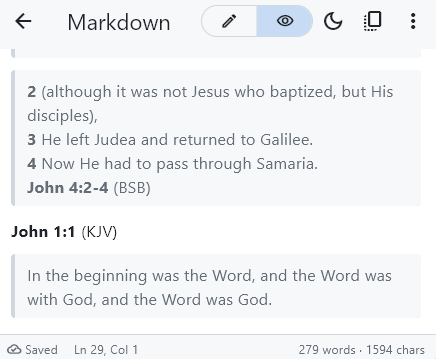

### Meme Maker

- Text layers with rotate, hide, and lock.
- Swappable fill and outline colors.
- Background image with zoom and lock, or a solid color.
- Layer panel, templates, and image strip: Upload Image, Download Image via URL. Reset Default Images.
- Export button with export options: Image Type and Sizes.

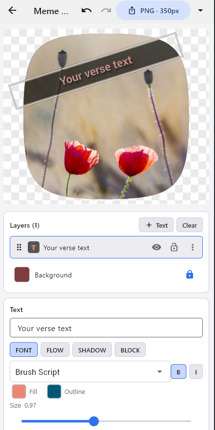

### Bible Chat (Offline AI)

- Runs a local LLM (GGUF) on-device, fully isolated and Offline.
- Model manager with download, backup, and catalog editing.
- Copy any chat segment or the whole chat.
- Reply-quote to ask follow-up questions.
- Unloads the model from memory when the app is swiped closed, without interrupting audio.
- Memory check refuses to load models the device can't handle.
- Opt-in: disabled by default.
- Default Prompt, that can be customized to keep topic focus.

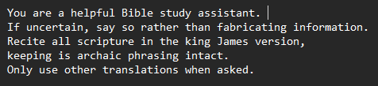

### Translations

- Download or import translations (.db, .dba, and zipped bundles).
- Export all translations to a zip, for offline restore.
- Deleting a translation offers to save it locally first.

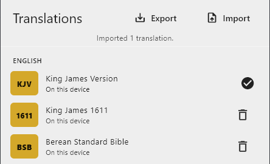

### Profile and Backup

- All settings, highlights, topics, notes, bookmarks, streaks, and history stored in `profile.db`
- Import (replace or merge by newest timestamp) and export your profile
- Import DBA v1 profiles
- Reset all settings without losing your content.

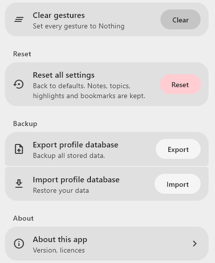

### Navigation and Gestures

- Customizable top and bottom bar gestures (swipes, double-tap, etc.).
- Android Back button closes sidebars.
- Swipe between OT / NT in the left sidebar and Gallery Tabs in right sidebar.

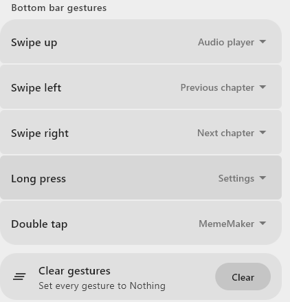

### Help and Info

- Built-in Help / Docs viewer
- About page with license and Git URL

###### Work In Progress.

### In App Downloads:

⚠️ *Data Usage Warning*: This app downloads several large asset packages totaling roughly 2.5 GB.

Each Bible translation is 30-40MB Currently: 18 exist
Each audio bible is 800MB - Currently 3 exist

If you do not have an unlimited mobile data plan (internet)!
We strongly recommend connecting to Wi-Fi before starting the download,

If Using AI then significantly more.
AI File Downloads from 2.5GB